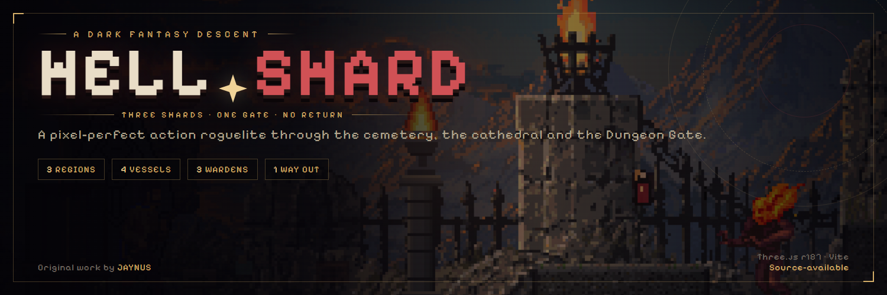
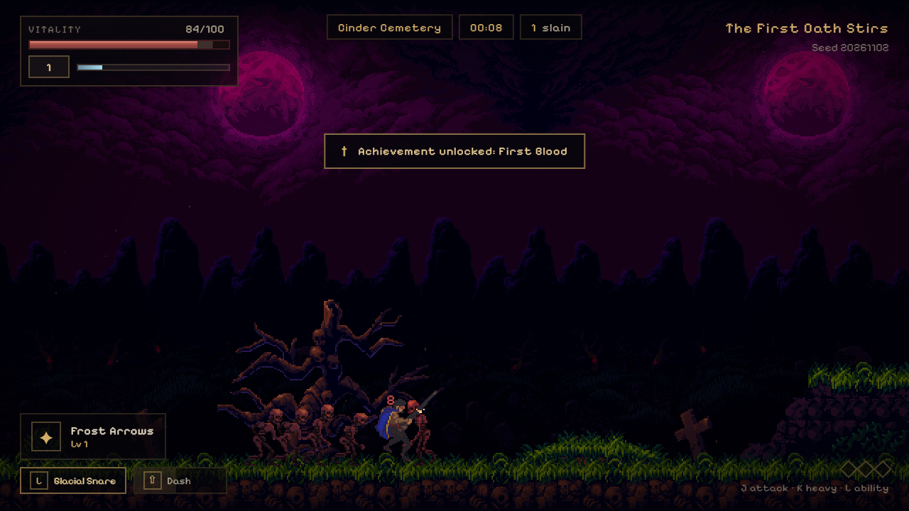
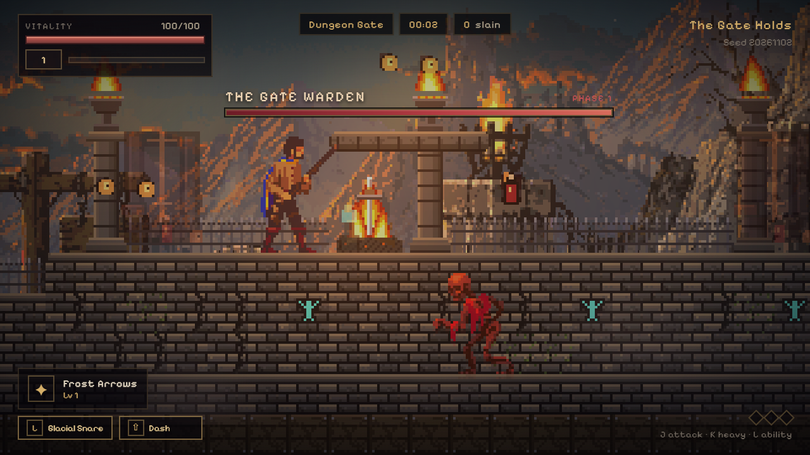
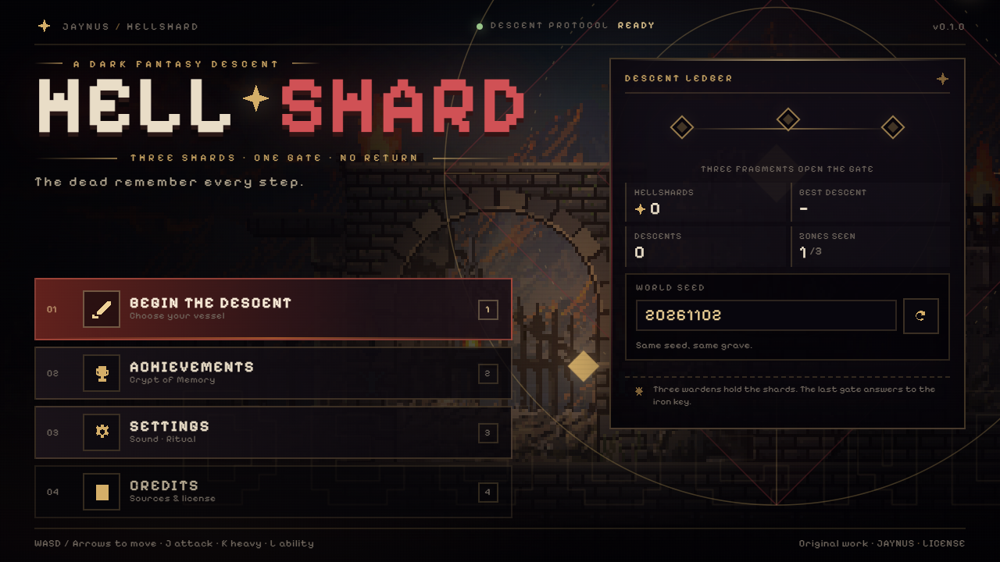
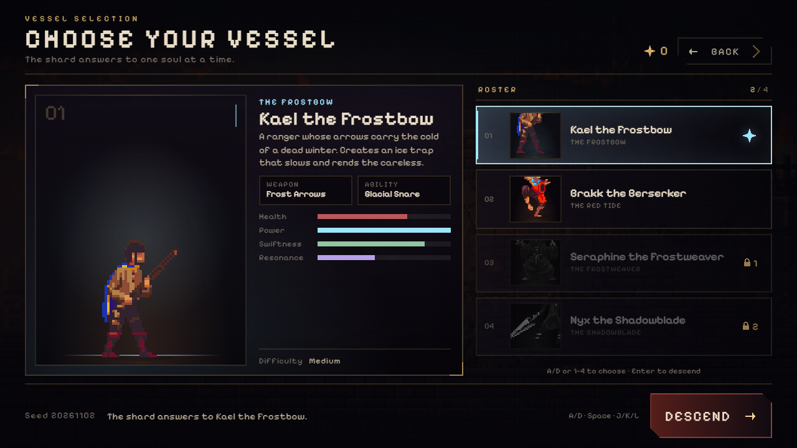

<div align="center">



# HELLSHARD

**A pixel-perfect dark-fantasy action roguelite built with Three.js and vanilla ES modules.**

Descend through the Cinder Cemetery and the Ashen Cathedral, breach the hand-authored
Dungeon Gate, claim three Hellshards, and open the last door.

[](https://threejs.org/)
[](https://vite.dev/)
[](#quality-gates)
[](#license)

**[Quick start](#quick-start)** · **[Screenshots](#screenshots)** · **[Controls](#controls)** · **[Deploy](#deploy)**

</div>

---

## What you get

| | |
|---|---|
| **4 playable vessels** | Kael the Frostbow, Brakk the Berserker, Seraphine the Frostweaver and Nyx the Shadowblade — unique weapons, abilities, stats and evolutions. |
| **3 connected biomes** | The packaged Tiled cemetery, a procedural cathedral and the hand-authored Dungeon Gate, linked by gates and fade transitions. |
| **3 phased wardens** | Mourning Maw, Seraph of Ash and the Gate Warden. Each guards a Hellshard and a guaranteed upgrade chest. |
| **Roguelite runs** | Seeded worlds, magnetic XP crystals, 13 capped upgrades, weapon evolutions, meta currency and 13 achievements. |
| **Combat feel** | Hitstop, knockback, crits, i-frame dashes, screen shake, pooled particles, damage numbers and synthesized SFX. |
| **Pixel-perfect rendering** | 640×360 internal resolution, integer letterbox scaling, nearest filtering, 2px atlas gutters and merged tile chunks. |

## Screenshots

<table>
  <tr>
    <td width="50%"></td>
    <td width="50%"></td>
  </tr>
  <tr>
    <td align="center"><sub><b>Cinder Cemetery</b> — skeletons, damage numbers and achievements</sub></td>
    <td align="center"><sub><b>The Gate Warden</b> — phase one, lava lift and torchlight</sub></td>
  </tr>
  <tr>
    <td></td>
    <td></td>
  </tr>
  <tr>
    <td align="center"><sub><b>Main menu</b> — live Dungeon Gate backdrop and descent ledger</sub></td>
    <td align="center"><sub><b>Vessel selection</b> — stats, abilities and unlock costs</sub></td>
  </tr>
</table>

## Quick start

```bash
git clone https://github.com/JaynusHUB/hellshard.git
cd hellshard
npm install
npm run dev
```

Open **http://127.0.0.1:5173**. No environment variables, API keys or external CDNs are required.

| Command | What it does |
|---|---|
| `npm run build` | Production build into `dist/` |
| `npm run preview` | Serve the production build locally |
| `npm test` | Run the Vitest logic suite |
| `npm run validate:world` | Validate seeded procedural worlds (`-- 1 300` for a range) |
| `npm run validate:maps` | Check packaged Tiled maps, GIDs, collision and spawns |
| `npm run validate:tiles` | Audit 16×16 frame rects, margins and spacing |
| `npm run validate:alignment` | Check alpha-painted surfaces and prop grounding |
| `npm run validate:layout` | Check 100 seeds for overlaps and unreachable platforms |
| `npm run inspect:tileset` | Measure Final tilesets and refresh the local inspection report |

## Controls

| Action | Keys |
|---|---|
| Move | `A` / `D` or `←` / `→` |
| Jump | `Space`, `W` or `↑` |
| Dash (i-frames) | `Shift` |
| Basic attack | `J` |
| Heavy attack | `K` |
| Character ability | `L` |
| Interact | `E` |
| Pause | `Esc` |
| Choose level-up card | `1`, `2`, `3` |
| Debug overlay | `F3` |

## Under the hood

| | |
|---|---|
| **Engine** | Three.js `0.187.0`, orthographic side view, WebGL2 |
| **Build** | Vite `8.3.5`, vanilla ES modules, no UI framework |
| **Simulation** | Fixed 60 Hz loop with render interpolation and pixel snapping |
| **Rendering** | Per-family canvas atlases, instanced sprite batches, chunk-merged static tiles |
| **Performance** | Spatial hash, object pools and adaptive spawn budget; 150 enemies + ~939 particles at 11 draw calls |
| **Audio** | Packaged cemetery OGGs plus runtime WebAudio synthesis for every other zone |
| **Persistence** | `localStorage` meta progression, unlocks, settings, achievements and run history |
| **Assets** | 100% local under `public/assets`; no runtime CDN requests |

## Quality gates

<details>
<summary><strong>Tests, validators and what they cover</strong></summary>

- **50/50 Vitest tests** across 11 suites: RNG determinism, upgrade caps and evolutions, seeded world generation, achievements, sprites, localization, Dungeon Gate loading and pit AI.
- **`validate:maps`** — both packaged Tiled maps load with valid GIDs, collision, spawn clearance and transitions.
- **`validate:world`** — seeds 1..100 produce 100 worlds / 200 procedural zones within the jump envelope.
- **`validate:layout`** — 100 seeds × 2 procedural zones with zero overlaps, floating chests or unreachable platforms.
- **`validate:tiles`** — five 16×16 catalogs, zero margin/spacing, every frame rect in bounds.
- **`validate:alignment`** — alpha-measured surface offsets and prop grounding within ±1px.
- **Fallow** — `.fallowrc.json` keeps dead-code scans clean; third-party asset demos are intentionally excluded.
- **Production build** — boots with no console errors and no failed requests.

</details>

## Project structure

<details>
<summary><strong>Source layout</strong></summary>

```text
src/config     gameplay, difficulty, upgrade and progression tunables
src/data       characters, enemies, bosses, zones and achievements
src/core       game orchestration, fixed loop, input, save data, audio, RNG
src/render     renderer, atlases, sprite batches, tile chunks, backgrounds, particles
src/world      seeded generation, collision, spatial hash and zone transitions
src/entities   player, enemies, bosses and player combat
src/systems    spawn director, progression, combat, bosses, interactions, achievements
src/ui         DOM screens, HUD, strings and feedback
public/assets  local third-party art packs plus the authored pool Dungeon Gate map
scripts/       world, map, tile, alignment and layout validators
tests/         Vitest suites
```

Detailed decisions live in [`HELLSHARD_SPEC.md`](HELLSHARD_SPEC.md), [`ARCHITECTURE.md`](ARCHITECTURE.md),
[`ASSET_REPORT.md`](ASSET_REPORT.md), [`PROGRESS.md`](PROGRESS.md) and [`CREDITS.md`](CREDITS.md).
Building another Tiled map? Start with [`MAP_AUTHORING.md`](MAP_AUTHORING.md).

</details>

## Deploy

The build is a static Vite bundle; no environment variables or server code are required.

### Vercel

1. Import the repository at [vercel.com](https://vercel.com).
2. Framework preset: **Vite**.
3. Build command: `npm run build`; output directory: `dist`.

`vite.config.js` uses a relative base, so the build also works from a subpath.

## License

The original HELLSHARD project — code, UI, game design, Dungeon Gate map assembly, generated
sprites and visual direction — is **© JAYNUS, all rights reserved**. It is **source-available,
not open source**.

If you use or reference any part of this project, credit **JAYNUS** and link to the
[original repository](https://github.com/JaynusHUB/hellshard). Copying, cloning, commercial use,
redistribution, resale, original-asset reuse and tutorial/course reproduction require written
permission. See [`LICENSE`](LICENSE) for the full terms.

The third-party art packs remain the property of their authors and keep their own licenses; do not
redistribute the dungeon or forest source art as standalone asset packs. See [`CREDITS.md`](CREDITS.md).
